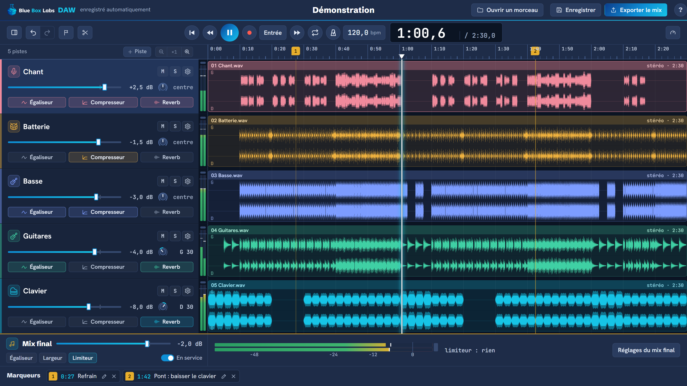
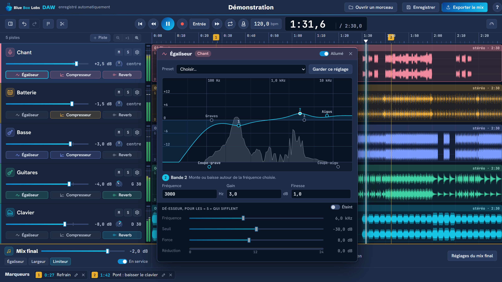
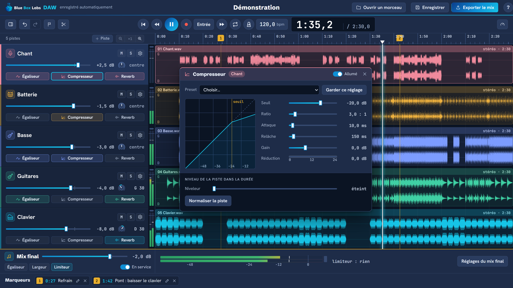
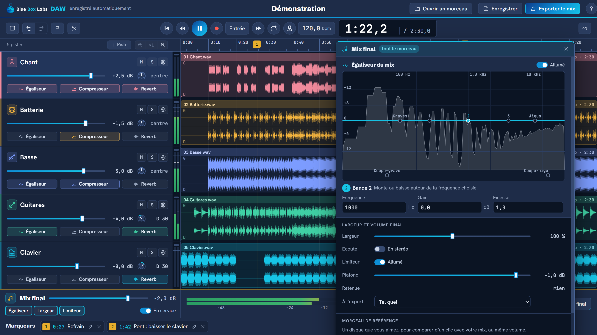
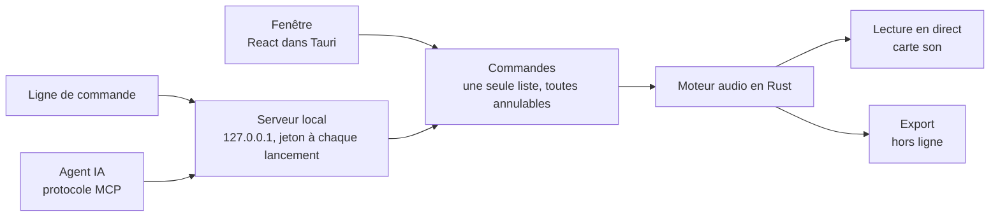

  <picture>
    <source media="(prefers-color-scheme: dark)" srcset="images/logo-fond-fonce.svg">
    
  </picture>

# Blue Box DAW

Un logiciel de mixage multipiste, simple à prendre en main. Vous ouvrez les pistes séparées d'un morceau (voix, batterie, basse, guitares…), vous réglez chaque piste, vous écoutez, vous exportez le mix.

**Télécharger : [dernière version](../../releases/latest)** · Windows 10 et 11 (64 bits), macOS

> Le code source de Blue Box DAW n'est pas publié. Ce dépôt contient la présentation du logiciel, ses installeurs et ses mises à jour.

Les captures montrent un morceau de démonstration dont les pistes sont synthétiques.

## Pourquoi ce logiciel

Blue Box Labs numérise et remet en état des enregistrements anciens. Une fois un morceau séparé en pistes, il reste à le remixer : rééquilibrer les instruments, éclaircir une voix, retirer une toux, sortir un fichier au bon volume.

Les stations audio du marché savent le faire, au prix de centaines de fonctions et d'un long apprentissage. Blue Box DAW ne garde que ce qui sert à mixer des pistes déjà enregistrées, avec des mots de tous les jours : « Graves », « Aigus », « Coupe-grave », « pour les s qui sifflent ».

## Installer

**Windows**

1. Télécharger `BlueBoxDAW_…_x64-setup.exe` sur la page de la [dernière version](../../releases/latest).
2. Lancer le fichier. Windows affiche « éditeur inconnu » : cliquer sur « Informations complémentaires », puis « Exécuter quand même ». Le logiciel n'a pas de certificat payant, c'est tout.
3. Ouvrir le logiciel, puis glisser dans la fenêtre le dossier qui contient les pistes du morceau.

**macOS**

Télécharger `BlueBoxDAW_…_universal.dmg` sur la même page, l'ouvrir et glisser l'application dans le dossier Applications.

Au lancement, le logiciel regarde s'il existe une version plus récente. Si oui, il dit ce qui change et propose de l'installer. Les morceaux, les presets et les réglages restent en place.

## Sur chaque piste

- Volume, pan, muet, solo, avec un niveau stéréo et un témoin de saturation.
- Égaliseur à cinq bandes et deux coupes, avec le spectre du son derrière la courbe.
- Compresseur, avec sa courbe et la réduction affichée en direct.
- Dé-esseur, pour les « s » qui sifflent.
- Reverb, avec six pièces toutes faites.
- Niveleur automatique et normalisation, pour une voix dont le niveau bouge.
- 24 presets par instrument, et les vôtres.

  
  

## Sur le mix entier

- Égaliseur général, largeur stéréo, écoute en mono.
- Limiteur : le mix ne sature plus, même poussé fort.
- Une ligne « Mix final », sous les pistes, avec un interrupteur pour comparer avec et sans.
- Morceau de référence : un disque que vous aimez, à comparer d'une touche avec votre mix, au même volume.
- Mesure du volume (LUFS) et de la crête.

## Retoucher les pistes

- Scinder une piste, retirer un passage (une toux, une phrase parlée), le raccourcir, le déplacer.
- Copier un bout qui est bon pour reboucher un passage raté.
- Volume et fondus propres à chaque clip.
- Boucle sur un passage, zoom, marqueurs avec texte, métronome.

Le fichier audio d'origine n'est jamais modifié, et tout s'annule avec Ctrl+Z.

## Ouvrir et exporter

Le logiciel ouvre des pistes en WAV, FLAC ou MP3. Le mix s'exporte en WAV 24 bits ou en FLAC 24 bits, au volume du mix ou à un volume choisi, par exemple celui des plateformes de streaming.

L'enregistrement par la carte son est présent, encore en essai.

## Raccourcis utiles

| Touche | Effet |
|---|---|
| Espace | Lecture ou pause |
| M, S | Couper la piste choisie, l'écouter seule |
| T | Scinder à la tête de lecture |
| B | Boucle |
| N | Poser un marqueur |
| R | Basculer entre le mix et le morceau de référence |
| Ctrl + molette | Zoomer sur la ligne de temps |
| Ctrl + Z | Annuler |

Le bouton « ? » en haut à droite du logiciel donne la liste complète.

## Sous le capot

| Choix | Raison |
|---|---|
| **Un seul chemin de calcul pour l'écoute et pour l'export.** Des tests vérifient que les deux sortent le même signal, au bit près | Le fichier exporté sonne exactement comme ce qui a été entendu pendant le réglage. |
| **Le fil qui alimente la carte son ne prend aucun verrou et n'alloue aucune mémoire.** Les réglages lui arrivent par des files d'attente sans blocage | Un réglage tourné pendant la lecture ne provoque pas de craquement. |
| **Tout le traitement du son est écrit pour le logiciel** : égaliseur, compresseur, dé-esseur, limiteur à anticipation, reverb | Chaque effet est mesuré par des tests chiffrés, et aucun greffon externe n'est à installer. |
| **Une seule liste de commandes** sert à la souris, à la ligne de commande et à un agent IA | Tout ce qui se fait à la main peut s'automatiser, et tout s'annule de la même façon. |
| **Le serveur local n'écoute que la machine elle-même**, exige un jeton renouvelé à chaque lancement et refuse les appels venus d'une page web | Un site ouvert dans le navigateur ne peut pas piloter le logiciel. |
| **Les réglages d'un morceau sont un fichier lisible rangé avec ses pistes.** Un fichier de réglages illisible n'est jamais écrasé | Le dossier se déplace ou se sauvegarde d'un bloc, et le travail survit à un accident de fichier. |

Le moteur est couvert par 117 tests automatisés, dont des séries de commandes tirées au hasard et des suites d'annulations comparées à l'octet près.

**Technologies** : Rust pour le moteur audio, Tauri 2 pour la fenêtre, React et TypeScript pour l'interface.

## Versions

Chaque version et ses notes sont sur la page des [versions](../../releases). L'historique résumé est dans [CHANGELOG.md](CHANGELOG.md).

## Licences

Le logiciel utilise des bibliothèques libres, dont l'encodeur MP3 [LAME](https://lame.sourceforge.io) (licence LGPL). La liste complète est fournie sur demande, à info@apptic.be.

Les fichiers nécessaires pour recompiler le logiciel avec une autre version de LAME sont fournis sur demande, à la même adresse.

## Blue Box Labs et Apptic

Blue Box DAW est l'outil de mixage de [Blue Box Labs](https://blueboxlabs.be). Il est développé par [Apptic](https://apptic.be), studio de développement sur mesure installé à Angleur (Liège).

Autres projets : [Time Shifter](https://github.com/bastienbrasseur/apptic-timeshifter), planning des équipes de terrain · [Ligne 43](https://github.com/bastienbrasseur/apptic-ligne-43), simulateur de train dans le navigateur · [tous les projets](https://github.com/bastienbrasseur/apptic)

---

© 2026 Blue Box Labs et Apptic. Tous droits réservés. Les textes et les images de ce dépôt ne peuvent pas être réutilisés sans accord écrit.
